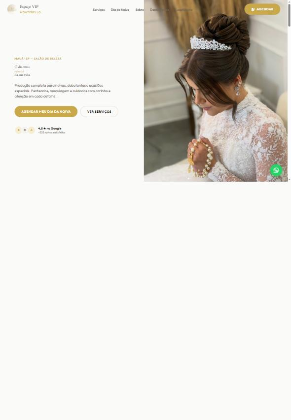

# Espaço VIP Montebello — Site



> Prévia: https://ponto-eletronico-gules.vercel.app/

---

## Estrutura de arquivos

```
Montebello/
├── index.html
├── 404.html
├── robots.txt
├── sitemap.xml
├── llms.txt
├── .gitignore
├── README.md
└── assets/
    ├── styles.css
    ├── app.js
    ├── tailwind-config.js
    ├── logo.jpg
    └── img/
        ├── hero-noiva.jpg
        └── noiva-detalhes.jpg
```

---

## Seções

| Seção | Âncora |
|---|---|
| Hero (proposta de valor + CTA) | `#hero` |
| Serviços (4 cards) | `#servicos` |
| Dia da Noiva (CTA dark) | `#dia-da-noiva` |
| Sobre (Eli + salão) | `#sobre` |
| Depoimentos (6 reviews Google) | `#depoimentos` |
| Perguntas frequentes | `#faq` |
| Localização + mapa | `#localizacao` |
| Footer | `#footer` |

---

## Tecnologia

- HTML5 + CSS3 + JavaScript (vanilla)
- [Tailwind CSS v3 via CDN](https://cdn.tailwindcss.com/3.4.1)
- Fontes: Cormorant Garamond + Outfit via Google Fonts
- Analytics: GoatCounter (sem cookies, sem banner)
- Sem build, sem backend, sem dependências npm

---

## Design tokens

```css
/* Cores */
--color-bg:           #FAFAF8   /* fundo principal */
--color-bg-alt:       #F5F3EF   /* fundo alternado */
--color-text:         #1C1917   /* texto principal */
--color-text-muted:   #6B6560   /* texto secundário */
--color-accent:       #C9A84C   /* dourado — cor de marca */
--color-accent-hover: #B8972D
--color-accent-light: #F7EDD3
--color-border:       #E8E4DC

/* Tipografia */
--font-display: 'Cormorant Garamond', Georgia, serif
--font-body:    'Outfit', system-ui, sans-serif

/* Espaçamento */
--section-py:    clamp(4rem, 8vw, 7rem)
--container-px:  clamp(1rem, 4vw, 2rem)
```

---

## Deploy e GoatCounter

### Deploy gratuito (escolha uma opção)

**GitHub Pages**
```bash
git init && git add . && git commit -m "first commit"
gh repo create montebello --public --source=. --push
# Ativar em Settings → Pages → Branch: main / root
```

**Netlify** — arraste a pasta `Montebello/` em [app.netlify.com/drop](https://app.netlify.com/drop)

**Cloudflare Pages** — conecte o repositório GitHub em [pages.cloudflare.com](https://pages.cloudflare.com)

### Domínio próprio

Após fazer deploy, adicione o domínio do cliente no painel do serviço escolhido.
**Remova o `<meta name="robots" content="noindex, nofollow">` de `index.html` e `404.html`** e atualize `canonical`, `sitemap.xml` e o JSON-LD com o domínio definitivo.

### GoatCounter

Script no `<head>` de `index.html`:
```html
<script data-goatcounter="https://teocode.goatcounter.com/count"
        async src="//gc.zgo.at/count.js"></script>
```

**Eventos rastreados (CTA clicks):**

| Evento | Localização |
|---|---|
| `cta-nav` | Botão "Agendar" na navbar |
| `cta-menu` | Botão no menu mobile |
| `cta-hero` | CTA principal do hero |
| `cta-dia-noiva` | CTA da seção Dia da Noiva |
| `cta-servico-noiva` | Card Dia da Noiva |
| `cta-servico-penteado` | Card Penteado |
| `cta-servico-maquiagem` | Card Maquiagem |
| `cta-servico-cabelo` | Card Cabelo |
| `cta-sobre` | CTA da seção Sobre |
| `cta-localizacao` | CTA da seção Localização |
| `cta-prefooter` | CTA pré-footer |
| `cta-flutuante` | Botão FAB WhatsApp |

Ver em: **Dashboard → Events** em [teocode.goatcounter.com](https://teocode.goatcounter.com)

> O domínio da prévia precisa estar cadastrado no painel do GoatCounter para os eventos aparecerem.
